<p align="center">
  
  
  
  
  
  
  
</p>

<h1 align="center">NoClickDock</h1>
<p align="center">Every status you need, with no click.</p>

<p align="center">
  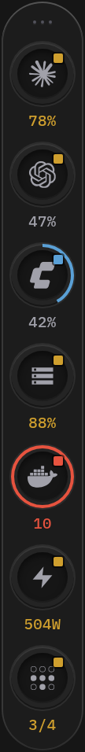
  &nbsp;&nbsp;
  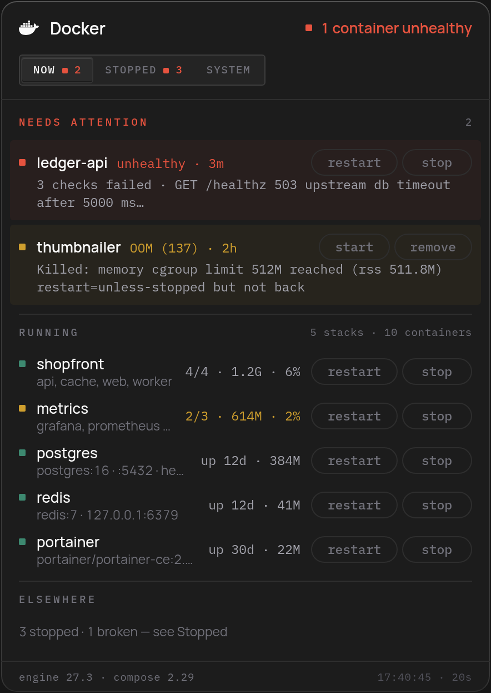
</p>

<p align="center"><sub>The rail, and the Docker panel it opens when you point at a dial. Every image here is drawn from invented data — see <a href="#screenshots">Screenshots</a>.</sub></p>

---

A small rail at the edge of your desktop with one dial per thing you care about — Claude, Codex, ComfyUI, your disks, Docker, the machine's power draw, your tailnet. Glance at it and you know. Point at a dial and the full picture opens beside it. You never click.

The rule behind every choice: **if you have to click to find out, the widget has failed.** Colour is used only for signal; a healthy dock is still, and a problem is the only thing that moves.

- **The rail** holds every widget in one capsule, vertical or horizontal, in three sizes. Drag it anywhere; it snaps to the nearest edge and remembers where it was.
- **A dial** is a widget: its mark, a lamp for its state, and a short reading under it (`54%`, `412W`, `3/4`). A ring appears only while something is critical or a job is running.
- **The panel** opens when the pointer rests on a dial, beside the rail so it never covers the other dials, and switches instantly as you move along the rail. Problems come first and in full; the healthy majority is condensed.
- **Toasts** appear beside the dial on a transition — a service degrading, a container going unhealthy, a GPU crossing a temperature — so you find out while you can still act.
- **Right-click** a dial for *Refresh now* and the widget's own actions (open a status page, open the power report, copy an address). **Settings** has the rest.

## The widgets

<table>
<tr><th width="340">Widget</th><th>What its panel says</th></tr>
<tr>
<td align="center" valign="top">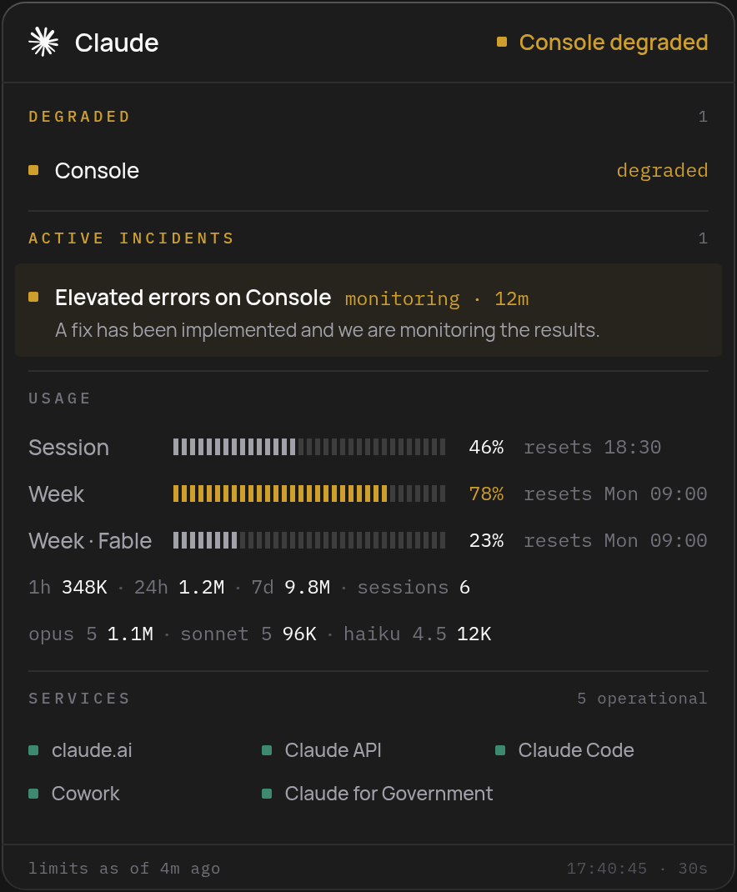<br /><strong>Claude</strong></td>
<td valign="top"><strong>Watches</strong> Anthropic's status page, your plan's limits, your local token spend.<br /><br />Degraded services and open incidents first. Then your limits — session, week, per-model — as meters with their reset time, read from the Claude Code CLI (a reading taken before a reset says so, in words, instead of a stale number). Token spend over 1 h / 24 h / 7 d from your local transcripts, each message counted once, subagents included. Healthy services as quiet chips.<br /><br /><sub>Every 30 s. Menu: open the status page.</sub></td>
</tr>
<tr>
<td align="center" valign="top">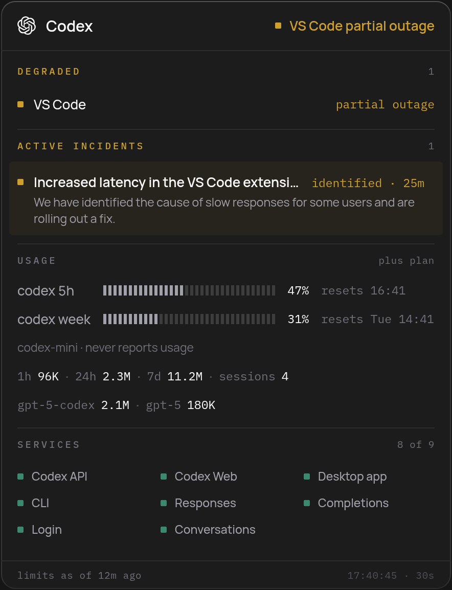<br /><strong>Codex</strong></td>
<td valign="top"><strong>Watches</strong> OpenAI's status page, your Codex limits, your local token spend.<br /><br />Broken components and incidents first, then every allowance's windows as meters with reset times, read from your local session rollouts (replayed history is not counted twice). A window whose reset has passed reads 0; a bucket that never moves is said in words. Token spend and the models that used it.<br /><br /><sub>Every 30 s. Menu: open the status page.</sub></td>
</tr>
<tr>
<td align="center" valign="top">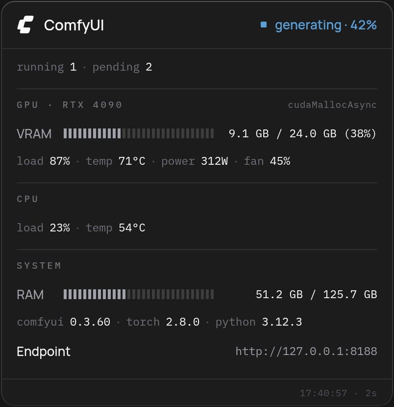<br /><strong>ComfyUI</strong></td>
<td valign="top"><strong>Watches</strong> a ComfyUI server — its queue, its devices and, when it runs on this machine, their temperatures.<br /><br />Running and pending jobs; every device the server reports with VRAM meters, load, temperature, power, fan; CPU; RAM and versions. The dial's arc shows progress when ComfyUI sends it to NoClickDock, and turns when it cannot. Offline is one sentence with the address it asked.<br /><br /><sub>Every 2 s, and a websocket. Menu: open ComfyUI.</sub></td>
</tr>
<tr>
<td align="center" valign="top">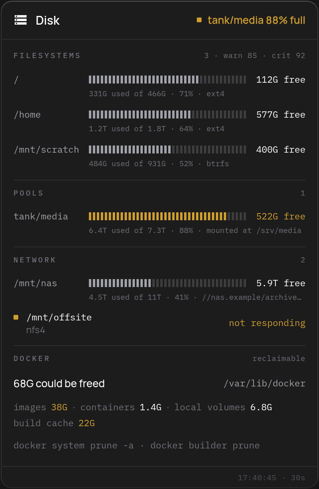<br /><strong>Disk</strong></td>
<td valign="top"><strong>Watches</strong> every real filesystem, network shares and ZFS pools, and what Docker could give back.<br /><br />Used, free and total per filesystem, warning at 85 % and critical at 92 % (filesystems misbehave long before 100 %). A share that stops answering says so rather than freezing the panel. Docker's reclaimable space with the commands that free it. Never deletes anything.<br /><br /><sub>Every 30 s. Menu: open Disk Usage Analyzer, when installed.</sub></td>
</tr>
<tr>
<td align="center" valign="top"><br />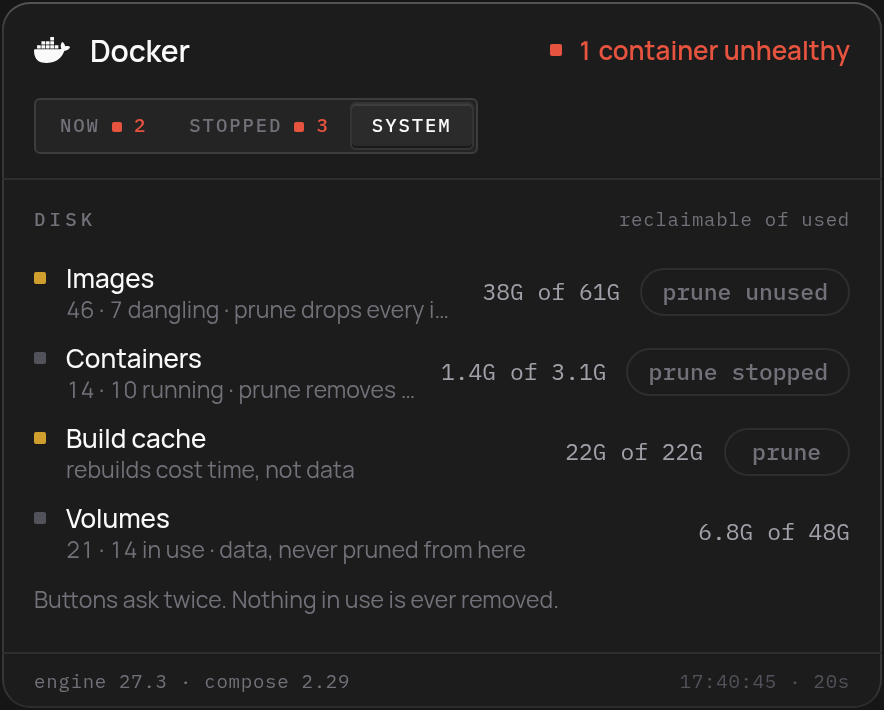<br /><strong>Docker</strong></td>
<td valign="top"><strong>Watches</strong> every container, grouped into Compose stacks, and the engine.<br /><br />Three pages, switched by pointing at a tab. <strong>Now</strong>: what needs attention (unhealthy, restarting, crashed — with the exit code and the last log line), then what runs, one row per stack. <strong>Stopped</strong>: broken, stopped this week, dormant. <strong>System</strong>: engine and Compose versions, counts, reclaimable space. Every start, stop, restart, remove and prune asks for a second click; volumes are never touched.<br /><br /><sub>Every 20 s. Menu: open Portainer, when it runs.</sub></td>
</tr>
<tr>
<td align="center" valign="top">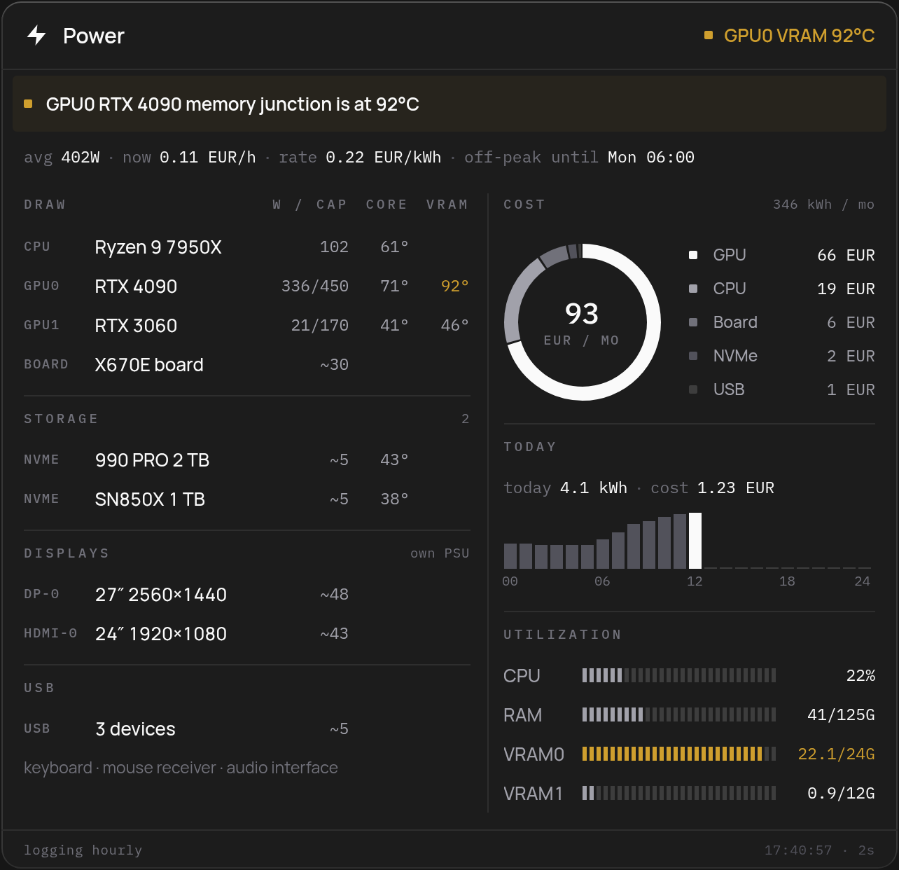<br /><strong>Power</strong></td>
<td valign="top"><strong>Watches</strong> the CPU package (RAPL), every GPU, drives, board, displays and USB — and what it all costs.<br /><br />One table of draw against each part's cap, with core and VRAM temperatures; the month's cost by component; today's kWh and cost with 24 hourly bars; memory in use. Flat or time-of-use tariffs, the current window on the panel. Thermal alerts first. An hourly log in <code>~/Documents/PM-Log</code> and a full HTML report rebuilt from it.<br /><br /><sub>Every 2 s. Menu: open the power report.</sub></td>
</tr>
<tr>
<td align="center" valign="top">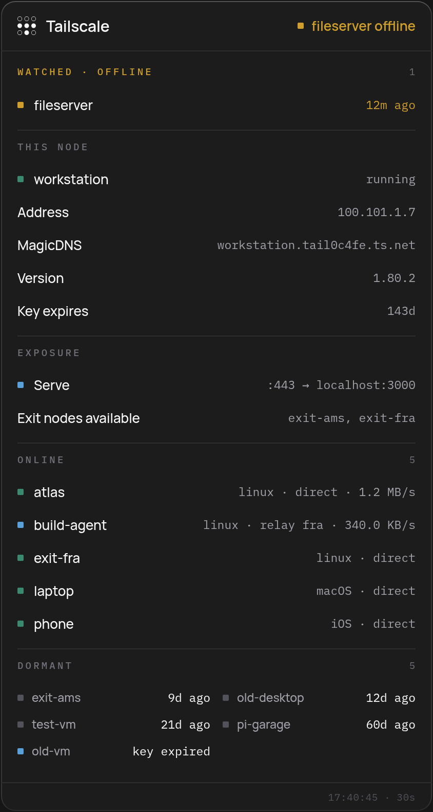<br /><strong>Tailscale</strong></td>
<td valign="top"><strong>Watches</strong> <code>tailscaled</code>, this node and every peer.<br /><br />Health warnings and watched peers that went offline first. This node's address, MagicDNS name, version and key expiry; what it exposes (a public Funnel is the one exposure that warns); exit nodes and routes. Online peers with their path and throughput; dormant ones, oldest last.<br /><br /><sub>Every 30 s. Menu: copy the address or the MagicDNS name.</sub></td>
</tr>
</table>

<p align="center">
  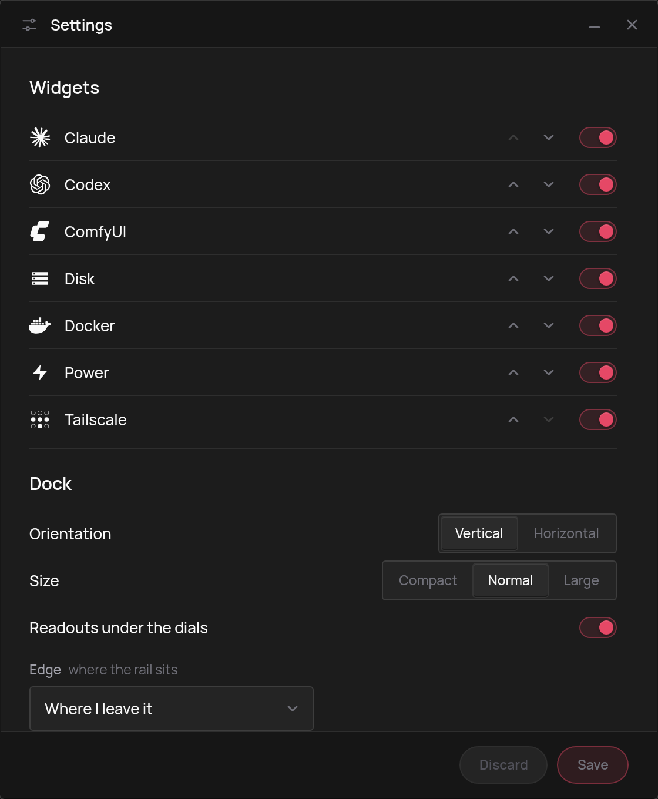
  &nbsp;&nbsp;
  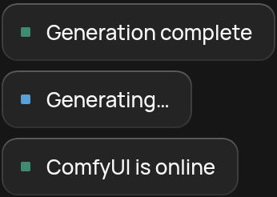
</p>

## Install

### Linux

```bash
git clone https://github.com/ShAInyXYZ/NoClickDock
cd NoClickDock
scripts/install.sh --build
```

`--build` compiles NoClickDock (it needs Go, Rust, pnpm and the WebKitGTK development files); `--from DIR` installs binaries you already have. It installs into `~/.local/share/noclickdock2`, adds a menu entry and a login entry, and starts the dock.

Coming from NoClickDock 1 (the Python widgets)? `scripts/install.sh --build --replace-legacy` brings your settings over — dock position, Tailscale watch list, power tariff, which widgets you ran, the ComfyUI endpoint — then stops the old widgets and disables their login entries. Nothing of theirs is deleted: `--restore-legacy` gives the login entries back. The power log in `~/Documents/PM-Log` carries on where it was.

Also: `--status`, `--uninstall` (your settings are kept), `--no-start`.

**Needs:** WebKitGTK 4.1 and GTK 3 (Debian/Ubuntu `libwebkit2gtk-4.1-0`), a compositing desktop (GNOME, KDE, or any X11 window manager with a compositor). The tray icon needs an AppIndicator library; without one, the rail's own menu has the same items. X11 is the primary target; on Wayland the compositor places the rail.

Each widget uses the tool it watches when it is there: the `claude` and `codex` CLIs' local files, `docker`, `tailscale`, `nvidia-smi`, a ComfyUI server. A missing one is said on its panel, never faked.

### Windows

```bash
scripts/build-windows.sh        # on Linux: cross-builds dist/windows/
```

Copy `dist/windows` to the Windows machine and run `.\install.ps1` there. It stops NoClickDock 1's widgets and moves their Startup shortcuts aside (`-RestoreLegacy` puts them back), checks the WebView2 runtime, installs into `%LOCALAPPDATA%\NoClickDock\bin` and starts NoClickDock at login.

**Status:** the Windows build compiles and its installer parses, but it has not yet been run on Windows. On Windows, Power reads NVIDIA GPUs and — with [LibreHardwareMonitor](https://github.com/LibreHardwareMonitor/LibreHardwareMonitor) running — the CPU package; displays, USB and drives are Linux-only for now.

### Optional: VRAM junction temperatures

`nvidia-smi` never shows GDDR6X memory temperature on Linux, and on cards with aged pads it is the limit that bites first. Power reads it through a small one-shot built on [gddr6](https://github.com/olealgoritme/gddr6), `tools/gddr6-oneshot.c`:

```bash
git clone https://github.com/olealgoritme/gddr6 && cd gddr6
cp /path/to/NoClickDock/tools/gddr6-oneshot.c app/src/
# add an executable target for it in app/CMakeLists.txt, then:
sudo apt install libpci-dev && mkdir build && cd build && cmake .. && make
sudo install -m 755 bin/gddr6-oneshot /usr/local/bin/
```

It needs root, and Power calls it with `sudo -n` — never a password prompt. Give your user passwordless sudo for exactly that binary, or skip it: the panel shows core temperatures and never breaks.

## Settings

Right-click the rail (or the tray) → **Settings…**, or run `ncd --settings`.

- **Widgets:** turn each on or off and set the rail's order. A widget turned off has no dial and does not run.
- **Dock:** orientation, size, readouts, the edge the rail sits on.
- **Start:** launch at login.
- **Tailscale:** watch the peers seen online, or only the ones you choose from your tailnet.
- **Power:** a flat or time-of-use tariff (with country presets), the estimates for the parts it cannot measure, how often it reads and logs.
- **ComfyUI:** the server's address, with a **Test** that says exactly what it asked and what answered.

Everything is kept in `~/.config/noclickdock/config.json` (`%APPDATA%\NoClickDock\config.json` on Windows), written only by NoClickDock itself; a value it cannot accept is refused beside its field.

The power log is `~/Documents/PM-Log/<YYYY-MM>/<date>.csv`, one row an hour, and `power-consumption-report.html` next to it is rebuilt after every row and from the menu — every sentence in it computed from the log, priced with your tariff.

## How it is built

- `core/` — **ncd-core**, in Go: every widget's collector, a hub that polls them and turns changes into toasts, and the config. It speaks JSON lines on stdin and stdout.
- `app/` — the shell, in [Tauri 2](https://tauri.app) (Rust) with the pages in Svelte 5: the rail, the panels, the toasts and Settings. It starts ncd-core as a sidecar and draws what it says.
- `DESIGN.md` — the interface contract; `docs/rewrite/` — the architecture, the specs each widget was ported from, and the review trail.

Development:

```bash
cd core && go run ./cmd/ncd-core --mock --port 47810   # invented data, over HTTP
cd app && pnpm install && pnpm dev                     # then open http://127.0.0.1:1420/gallery
cd app && pnpm tauri dev                               # the real windows, on this machine's data
```

`ncd --mock` runs the real windows on invented data that moves, and `ncd --instance <name>` keeps a development run apart from an installed one. Tests: `go test ./...` in `core/`, `cargo test` in `app/src-tauri/`, `pnpm check` in `app/`.

## Screenshots

Every image in this repository is drawn from invented data. A status panel's whole job is to show what you run, so a screenshot of a real one publishes container names, hostnames, tailnet addresses, filesystems and hardware. The gallery (`/gallery`, above) draws every panel from `ncd-core --mock` with the real components, and `docs/rewrite/design/shoot.mjs` captures them:

```bash
node docs/rewrite/design/shoot.mjs http://127.0.0.1:1420 out/ --scales 2
```

**Please do not replace these with captures of a live machine.**

## License

MIT — see [LICENSE](LICENSE).
